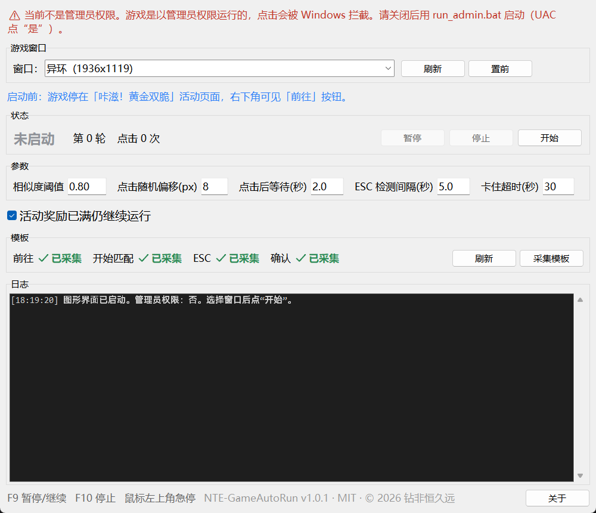

# NTE-GameAutoRun

指定 Windows 游戏窗口，用截图模板匹配识别按钮并自动点击，循环执行匹配流程。

**v1.1** · Windows 10/11 x64 · MIT · [AI 生成声明](AI_DISCLOSURE.md)



## 功能

- 绑定窗口，模板匹配按钮并自动点击
- 循环流程：前往 → 开始匹配 → ESC → 确认 → 结算 / 前往
- 对局中按键盘 ESC，结算界面自动按第二次 ESC
- “已获得 X/Y”打满后自动停止，可勾选“活动奖励已满仍继续运行”
- 单步卡住超时后进入特殊轮，快速扫描并回到正常流程
- GUI 控制、参数自动保存、实时日志
- 点击随机偏移，点击后鼠标停留在按钮上
- 管理员权限检测
- 模板已内置（前往、开始匹配、ESC ×3、确认），下载即用

## 下载

- [Releases](../../releases/latest) 下载 `NTE-GameAutoRun-v1.1-win64.zip`
- 解压后运行 `NTE-GameAutoRun.exe`（建议以管理员身份运行）

源码运行：

```powershell
python -m venv .venv
.venv\Scripts\pip install -r requirements.txt
.venv\Scripts\python gui.py
```

## 使用

1. 游戏设为**窗口化 / 无边框窗口**，停在「咔滋！黄金双脆」活动页面（右下角有「前往」按钮）
2. 右键 `NTE-GameAutoRun.exe` → **以管理员身份运行**
3. 选择游戏窗口 → 点“开始”

模板已内置，无需采集。

热键：`F9` 暂停/继续，`F10` 停止，鼠标移到屏幕左上角急停。

## 模板

- 已内置在 `templates/`：`前往.png`、`开始匹配.png`、`ESC.png`、`ESC_2.png`、`ESC_3.png`、`确认.png`
- 如需替换，直接替换同名 png；同一按钮支持 `_2`、`_3` 多张，程序取最高分
- `templates/meta.json` 记录采集时的窗口尺寸，换分辨率后模板按比例缩放

## 配置

`gui_settings.json`（GUI 自动生成）：

| 字段 | 默认 | 说明 |
| --- | --- | --- |
| `threshold` | 0.85 | 模板相似度阈值 |
| `click_jitter` | 4 | 点击随机偏移（像素） |
| `wait_after_click` | 3.0 | 点击后等待（秒） |
| `esc_interval` | 3.0 | ESC 检测间隔（秒） |
| `step_timeout` | 60 | 单步卡住超时（秒） |
| `ignore_progress_full` | false | 活动奖励已满仍继续运行 |

更多参数见 `config.example.json`。

## 适配

- Windows 10/11 x64
- **游戏客户区 1920x1080，允许 ±10%**（如 1936x1119 可用；超出范围会提示并阻止启动）
- 窗口化、无边框全屏
- 高 DPI、多显示器
- 管理员 / 普通权限（启动时检测）
- 中文路径

## 构建

```powershell
.\build.ps1
```

输出：

- `dist\NTE-GameAutoRun.exe`
- `release\NTE-GameAutoRun-v1.1-win64.zip`（含 exe 和 templates）

## 版本

- 版本号唯一来源：`version.py`
- 变更记录：`CHANGELOG.md`
- 发布打 tag：`git tag v1.1`

## 免责声明

仅供学习与自动化研究。游戏自动化可能违反游戏服务条款，账号风险自负。

## 许可

MIT License · © 2026 钻非恒久远

AI 声明：本项目在 AI 编程助手辅助下完成，详见 [AI_DISCLOSURE.md](AI_DISCLOSURE.md)。
